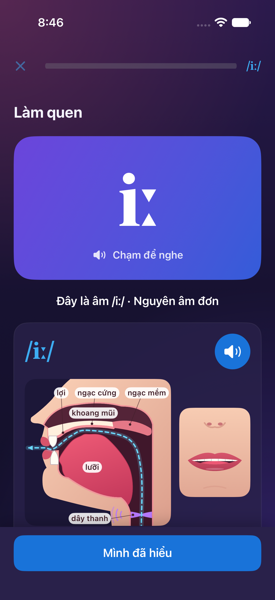
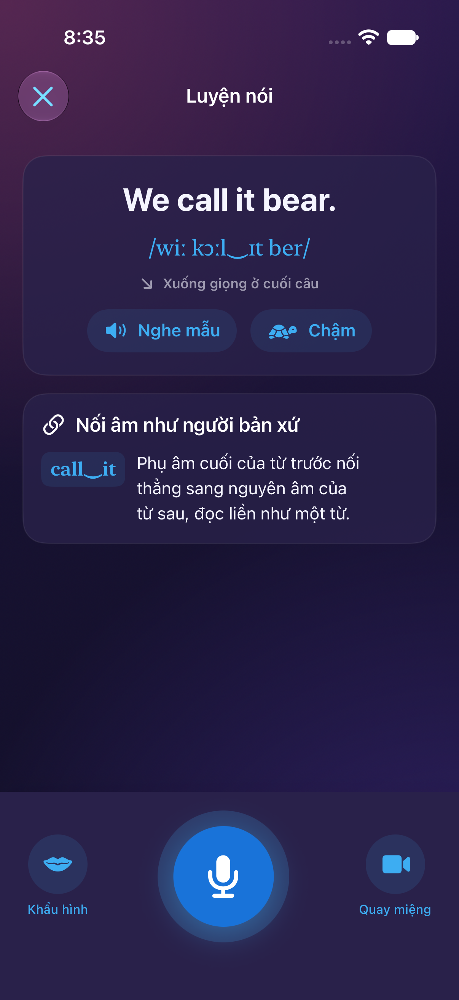
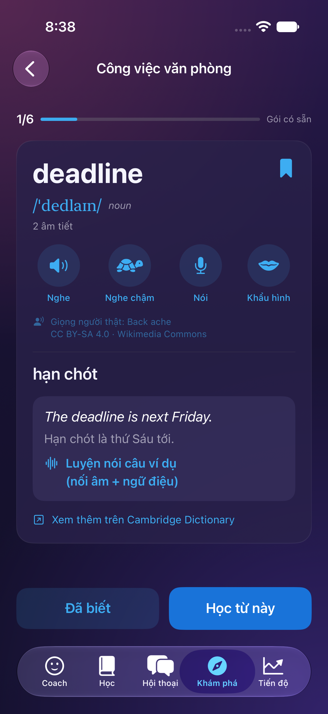
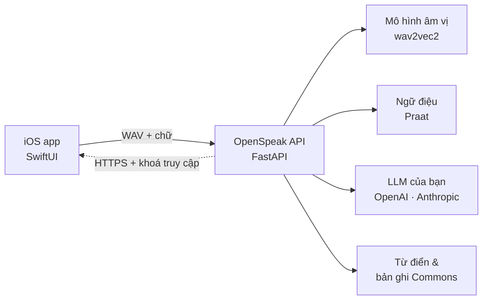

<div align="center">
  
  <h1>OpenSpeak</h1>
  <p><strong>Luyện phát âm tiếng Anh cho người Việt.<br>Chấm từng âm vị, trọng âm, ngữ điệu và nối âm, trên máy chủ của chính bạn.</strong></p>
  <p>
    
    
    
    
    
  </p>
</div>

<br>

<table>
  <tr>
    <td></td>
    <td></td>
    <td></td>
  </tr>
</table>

## Tổng quan

OpenSpeak là một sản phẩm học phát âm hoàn chỉnh, gồm **app iOS** và **API chấm điểm tự host**. Không cần tài khoản, không có cơ sở dữ liệu người dùng: tiến độ nằm trên máy, còn máy chủ chỉ chấm âm thanh bạn gửi lên.

- **Chấm thật, không phải chuyển giọng nói thành chữ.** Một mô hình âm vị nghe trực tiếp bản ghi và trả về âm bạn đã nói, nên lỗi như /θ/ đọc thành /s/ không bị mô hình nhận dạng tự sửa mất.
- **Cá nhân hoá theo dữ liệu của bạn.** Lộ trình chọn âm cần luyện từ điểm nói từng âm, lỗi nghe và bài đã học; độ khó tăng hoặc giảm theo kết quả thật.
- **Từ vựng do AI soạn, đúng chủ đề và trình độ.** Mỗi bài 6 từ, tránh từ đã học và lồng lại từ hay sai; nhớ lại bằng nghĩa, chính tả và một câu mới, app tự chấm.
- **Mang LLM của riêng bạn.** OpenAI Chat Completions, OpenAI Responses hoặc Anthropic Messages; khoá lưu trong Keychain và chỉ gửi tới máy chủ của bạn.
- **Chạy được cho một người hoặc một nhóm.** Mỗi người một khoá truy cập, có giới hạn tần suất, kích thước và số yêu cầu nặng chạy cùng lúc.

## Tính năng

| Học | Luyện | Theo dõi |
|---|---|---|
| Lộ trình nền tảng 15 bài, mỗi bài 6 bước | Luyện nói với micro, chữ tô màu theo điểm từng từ | Điểm từng âm, trọng âm, ngữ điệu, nối âm |
| Lộ trình cá nhân không điểm kết thúc | Bốn dạng câu hỏi nghe: chuỗi, nghe chép, phân loại, ghép phiên âm | Biểu đồ radar 6 kỹ năng, mức CEFR ước lượng |
| Lộ trình từ vựng AI theo chủ đề và tình huống | Cặp âm tối thiểu, đọc phiên âm, nhận mặt ký hiệu | Chuỗi ngày học, XP, từ đã nhớ |
| 24 chủ đề cho người đi làm | Khẩu hình động và hướng dẫn cấu âm từng bước | Lỗi hay gặp và âm cần ôn |
| Hội thoại công sở với AI, 8 tình huống | Chấm phát âm ngay trong từng lượt chat | Bài kiểm tra sau mỗi 4 bài |

## Cách hoạt động



Điểm từng âm được hiệu chỉnh trên speechocean762, kiểm tra độc lập trên L2-ARCTIC (có người Việt) và LibriSpeech. Mô hình đang dùng đạt tương quan **0,548** với điểm chuyên gia ở cấp âm, **0,501** ở cấp từ và **0,694** ở cấp câu; ngưỡng "Đúng" là 89/100. Chi tiết và giới hạn ở mục [Chất lượng chấm điểm](#chất-lượng-chấm-điểm).

## Bắt đầu nhanh

**Yêu cầu:** Python 3.9+ cho API, Xcode 15+ và iOS 17+ cho app. Lần chấm đầu tải mô hình khoảng 1,2 GB và cần khoảng 2 GB RAM.

### 1. Chạy API

```bash
git clone https://github.com/leduyphuc1702/openspeak.git
cd openspeak/backend
python3 -m venv .venv
.venv/bin/pip install -r requirements.txt
.venv/bin/uvicorn app.main:app --host 0.0.0.0 --port 8000
```

Mở `http://localhost:8000/health`. Trong app: **Hồ sơ → Máy chủ AI → `http://<IP-máy-tính>:8000` → Kiểm tra kết nối**.

### 2. Chạy app

```bash
cd ios
brew install xcodegen
xcodegen generate
open OpenSpeak.xcodeproj
```

Chọn Team ký trong Signing rồi chạy. Simulator dùng `http://localhost:8000`; máy thật dùng địa chỉ nhập trong Hồ sơ hoặc `ios/Config/Server.local.xcconfig` (file này không đưa lên git).

## Cài trên iPhone từ GitHub Releases

Mỗi bản phát hành có `OpenSpeak-<phiên bản>-unsigned.ipa` và file `.sha256`. IPA **chưa ký**, không kèm chứng chỉ, provisioning profile, UDID hay địa chỉ máy chủ.

1. Tải IPA ở [Releases](https://github.com/leduyphuc1702/openspeak/releases).
2. Ký lại bằng Apple ID của bạn bằng Sideloadly hoặc AltStore rồi cài.
3. Bật **Cài đặt → Quyền riêng tư & Bảo mật → Chế độ nhà phát triển**.
4. Trong app, nhập địa chỉ máy chủ và khoá truy cập (nếu có).

Apple ID miễn phí chỉ chạy được 7 ngày, sau đó ký lại. Tài khoản Developer thì lâu hơn. Camera đo khẩu hình cần máy thật.

## Dùng LLM của riêng bạn

**Hồ sơ → Dùng LLM riêng**, chọn định dạng, nhập địa chỉ API, model và khoá, bấm **Lưu** rồi **Kiểm tra LLM**.

| Định dạng | Địa chỉ mẫu | Dùng với |
|---|---|---|
| OpenAI Chat Completions | `https://api.openai.com/v1` | OpenAI, OpenRouter, Groq, Ollama, vLLM |
| OpenAI Responses | `https://api.openai.com/v1` | OpenAI Responses API |
| Anthropic Messages | `https://api.anthropic.com` | Claude |

Khoá nằm trong Keychain của máy và được gửi kèm **từng yêu cầu** tới máy chủ của bạn trong header `X-LLM-*`; máy chủ dùng khoá đó cho đúng yêu cầu ấy, không lưu. Máy chủ chỉ gọi những địa chỉ `https` công khai, nên không bị dùng để quét mạng nội bộ. Không bật LLM riêng thì app dùng LLM cấu hình trên máy chủ, nếu có.

## Host cho nhiều người

Một tiến trình đủ cho một nhóm nhỏ: mô hình chiếm khoảng 2 GB RAM, nên chạy `--workers 1`. Mỗi người một khoá, đặt trong `OPENSPEAK_API_KEYS` (cách nhau bằng dấu phẩy). Người học nhập khoá ở **Hồ sơ → Máy chủ AI**; app gửi `Authorization: Bearer <khoá>`.

```bash
# Sinh khoá cho từng người
openssl rand -hex 24
```

| Biến môi trường | Mặc định | Việc |
|---|---|---|
| `OPENSPEAK_API_KEYS` | trống | Khoá truy cập, mỗi người một khoá. Trống = máy chủ mở, chỉ dùng khi thử trên máy. |
| `OPENSPEAK_RATE_LIMIT` | `120` | Số yêu cầu mỗi phút cho một khoá (hoặc một IP khi không đặt khoá). Vượt thì trả 429 kèm `Retry-After`. |
| `OPENSPEAK_MAX_BODY_MB` | `16` | Kích thước yêu cầu tối đa. Ảnh khẩu hình cần chỗ, nên đừng đặt quá thấp. |
| `OPENSPEAK_MAX_CONCURRENT` | `2` | Số yêu cầu nặng (chấm điểm, LLM, audio) chạy cùng lúc; yêu cầu khác chờ rồi nhận 503. |
| `OPENSPEAK_QUEUE_SECONDS` | `2` | Thời gian chờ tối đa trước khi trả 503. |
| `OPENSPEAK_ACCESS_LOG` | `1` | Ghi một dòng mỗi yêu cầu với mã băm của khoá, không bao giờ ghi khoá. `0` để tắt. |
| `TRUST_PROXY` | `0` | Đặt `1` khi chạy sau nginx/Caddy để dùng `X-Forwarded-For`. |
| `LLM_CLIENT_CONFIG` | `1` | Cho phép người học gửi LLM riêng. `0` để bắt buộc dùng LLM của máy chủ. |
| `LLM_ALLOW_PRIVATE_URLS` | `0` | Chỉ bật khi thử LLM trên localhost; để `1` trên máy chủ công khai là mở đường SSRF. |

Mẫu systemd và biến môi trường ở [`deploy/`](deploy), mẫu nginx ở [`deploy/nginx.conf.example`](deploy/nginx.conf.example): TLS, giới hạn body 16 MB, `proxy_read_timeout 300s`, uvicorn chỉ nghe `127.0.0.1:8000`.

### Phòng thủ cơ bản đã có

| Lớp | Cách làm |
|---|---|
| Xác thực | Khoá tĩnh so sánh bằng `hmac.compare_digest`; nhận `Authorization: Bearer` hoặc `X-API-Key`. `/health` và `/download` để mở. |
| Giới hạn tần suất | Cửa sổ trượt 60 giây theo khoá (hoặc IP khi mở), trả 429 kèm `Retry-After` và `X-RateLimit-*`. |
| Giới hạn tải | Chặn theo `Content-Length` và đếm byte khi nhận, trả 413 trước khi chạm mô hình. |
| Giới hạn đồng thời | Semaphore cho các endpoint nặng, trả 503 kèm `Retry-After` thay vì treo máy. |
| Chống SSRF | Địa chỉ LLM do người học gửi phải là `https`, phân giải ra IP công khai; chặn loopback, LAN và `169.254.169.254`. |
| Không lộ khoá | Log chỉ ghi 12 ký tự đầu của SHA-256; không log header, body hay khoá LLM; `Cache-Control: no-store`. |
| Dữ liệu | Không tài khoản, không cơ sở dữ liệu người dùng; tiến độ ở trên máy, máy chủ chỉ giữ cache audio từ điển. |

### Danh sách kiểm tra khi mở ra Internet

- [ ] Bật HTTPS (nginx/Caddy), đặt `TRUST_PROXY=1`, đóng cổng 8000 với bên ngoài.
- [ ] Đặt `OPENSPEAK_API_KEYS`, mỗi người một khoá; không dùng chung khoá.
- [ ] Để `LLM_ALLOW_PRIVATE_URLS=0` và `LLM_CLIENT_CONFIG=1` để mỗi người tự trả tiền LLM.
- [ ] Không đặt `LLM_API_KEY` của riêng bạn trên máy chủ công khai, trừ khi chỉ phục vụ nhóm tin cậy.
- [ ] Theo dõi số 429/503 và thời gian chấm; đổi khoá khi có người rời nhóm (sửa env rồi restart).
- [ ] Không commit `.env`, chứng chỉ, UDID hay địa chỉ máy chủ vào repo.

**Giới hạn:** khoá là tĩnh, chưa có đăng ký tài khoản, phân quyền theo người hay bảng chi phí; giới hạn tần suất nằm trong bộ nhớ một tiến trình, nên chạy một worker. Muốn nhiều máy chủ thì cần thêm Redis và một lớp tài khoản.

## Chất lượng chấm điểm

Điểm từng âm là tương quan Pearson với điểm của chuyên gia trên speechocean762 (thang 0–100). AUC là xác suất một âm bị đánh sai có điểm thấp hơn một âm đúng; 0,5 là đoán bừa.

| Mô hình | Âm | Từ | Câu | AUC L2-ARCTIC | Báo sai nhầm người bản xứ |
|---|---|---|---|---|---|
| `mrrubino/wav2vec2-large-xlsr-53-l2-arctic-phoneme` **(đang dùng)** | **0,548** | **0,501** | 0,694 | 0,939 | 8,4% |
| `Peacockery/hubert-base-phoneme-en` | 0,503 | 0,479 | **0,726** | 0,671 | **4,7%** |
| `facebook/wav2vec2-lv-60-espeak-cv-ft` | 0,459 | 0,425 | 0,667 | 0,665 | 19,7% |

Mô hình được chọn theo tương quan cấp âm trên speechocean762, bộ không mô hình nào được huấn luyện trên đó; bootstrap 1.000 lần cho thấy khoảng cách là thật (mrrubino hơn HuBERT +0,045, CI 95% [+0,030; +0,059]).

**Giới hạn:** điểm ngữ điệu gần như không khớp đánh giá "prosodic" của chuyên gia, nên chỉ nên xem là gợi ý lên/xuống giọng. Số người Việt có chú thích tay còn ít; /ð/ và /ɝ/ là hai âm khó phát hiện nhất.

## API

Mọi endpoint dưới `/v1` cần khoá nếu máy chủ đặt `OPENSPEAK_API_KEYS`; `/health` luôn mở.

| Endpoint | Việc |
|---|---|
| `GET /health` | Trạng thái, có LLM hay không, đang bật xác thực hay không |
| `POST /v1/assess` | Chấm một bản ghi: âm vị, trọng âm, ngữ điệu, trôi chảy, nối âm |
| `GET /v1/phonemize?text=` | Phiên âm, nối âm, chỗ nối, ngữ điệu cần có |
| `POST /v1/exercises` | Câu hỏi nghe cho một âm |
| `POST /v1/path/next`, `/v1/path/exam` | Bài kế tiếp và bài kiểm tra của lộ trình cá nhân |
| `POST /v1/vocab/next`, `/v1/vocab/lesson` | Lộ trình từ vựng và bài từ mới theo chủ đề |
| `POST /v1/roleplay/start`, `/turn` | Hội thoại công sở, chấm phát âm từng lượt nói |
| `POST /v1/articulation-feedback` | Số đo môi và ảnh cận miệng → nhận xét khẩu hình |
| `GET /v1/dictionary/{word}` | Phiên âm, nghĩa, đường dẫn sang Cambridge |
| `GET /v1/audio/word/{word}` | Bản ghi giọng Mỹ từ Wikimedia Commons, kèm ghi công |
| `POST /v1/llm/check` | Gọi thử LLM đang dùng |

## Kiểm thử

```bash
cd backend && .venv/bin/python -m pytest -q        # 124 test
cd ios && xcodegen generate
xcodebuild -project OpenSpeak.xcodeproj -scheme OpenSpeak \
  -destination 'platform=iOS Simulator,name=iPhone 17' test
```

Bộ UI có 19 kịch bản đi qua mọi màn và lưu ảnh vào `docs/ui-walkthrough/`, gồm cả cỡ chữ Accessibility XL và kiểm tra nút thao tác chính luôn nằm trong màn hình. Backend test chạy không cần torch: bộ nhận dạng được giả lập.

## Cấu trúc

```
backend/            FastAPI: chấm điểm, lộ trình, từ vựng, hội thoại, bảo mật
  app/security.py   khoá truy cập, rate limit, giới hạn body và đồng thời
  app/scoring.py    âm vị, trọng âm, ngữ điệu, nối âm
  tools/            sinh nội dung bài học, hiệu chỉnh mô hình
ios/                SwiftUI, XcodeGen, unit test và UI test
deploy/             systemd, biến môi trường, mẫu nginx
docs/               ảnh chụp màn hình và ghi chú
```

## Giới hạn

- Chỉ có iOS 17+; chưa có Android hay bản web.
- IPA phát hành chưa ký; mỗi người phải ký lại bằng Apple ID của mình.
- Mô hình âm vị và dữ liệu hiệu chỉnh chỉ dùng **phi thương mại**.
- Chấm điểm là công cụ luyện tập, không thay thế giáo viên hay bài thi chuẩn hoá.
- Khoá truy cập tĩnh, chưa có đăng ký, phân quyền, thanh toán hay hạn mức theo người.

## Ghi công

- Mô hình: wav2vec2 XLSR-53 tinh chỉnh trên L2-ARCTIC (`mrrubino`), hiệu chỉnh trên speechocean762; chỉ dùng phi thương mại.
- Phiên âm: CMU Pronouncing Dictionary. Nghĩa: Wiktionary (CC BY-SA) hoặc LLM của bạn.
- Bản ghi từ: Wikimedia Commons (thường CC BY-SA), hiện tên người đọc và giấy phép trên thẻ từ.
- Cao độ: Praat qua parselmouth. Biểu tượng: SF Symbols. Giao diện, hình khẩu hình và icon đều tự làm bằng code.
